# SPRING_BOOT_20250646

자바웹프로그래밍(2) 수업 실습 프로젝트입니다.

- GitHub 저장소: https://github.com/Yoonsoooo/SPRING_BOOT_20250646

## 1주차 - 개발환경 설정

- JDK, VS Code, Spring Boot 프로젝트 생성 (실행 화면은 2주차부터)
- 실행 화면 사진 : [docs/images](docs/images) (캡처용 서버를 H2 메모리 DB + 샘플 계정으로 띄워 촬영, 실제 MySQL 데이터와 무관)

## 2주차 - 개발환경 설정 및 테스트

- JDK 25와 Spring Boot 4.1.1 설정
- `DemoApplication` 실행 및 8080 포트 확인
- `/hello`, `/hello2` URL 매핑 구현
- Thymeleaf Model 속성 5개 출력
- [DemoController.java](src/main/java/com/example/demo/controller/DemoController.java)
- [hello.html](src/main/resources/templates/hello.html) / [hello2.html](src/main/resources/templates/hello2.html)


#### 실행 화면

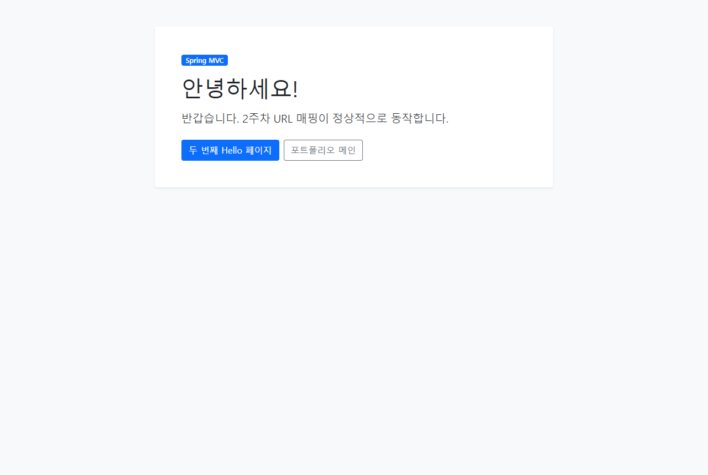
*/hello : 컨트롤러 → Thymeleaf 출력*

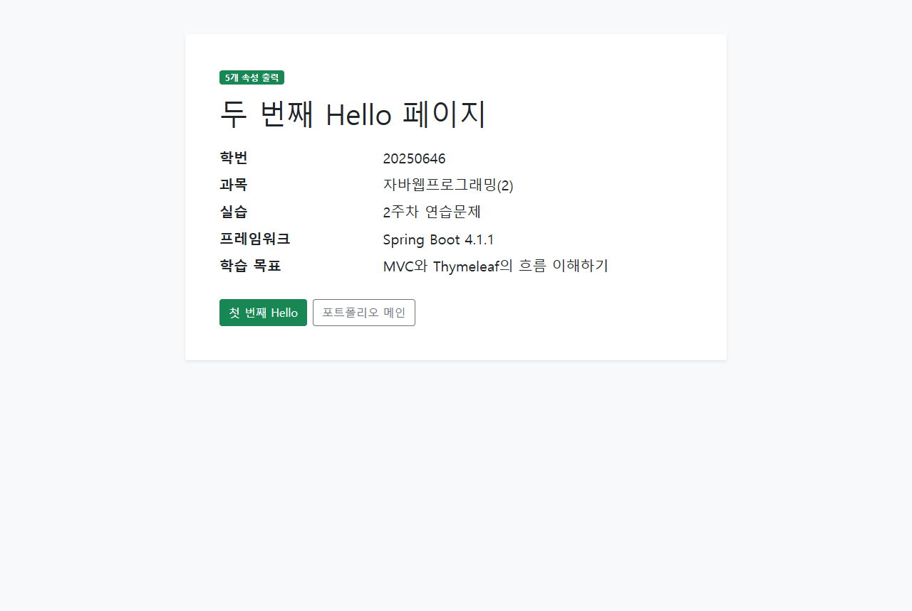
*/hello2 : Model 속성 5개 출력*


## 3주차 - 포트폴리오 프론트

- TemplateMo 578 First Portfolio의 600줄대 원본 전체 구조를 유지하여 Spring Boot 구조로 배치
- CSS, JavaScript, 이미지, 폰트를 `static` 폴더로 분리
- Thymeleaf 자원 경로 적용
- 한글 네비게이션과 개인 학습 소개 작성
- 웹, AI, 보안, 게임 기술 카드와 상세 페이지 작성
- PC/모바일 반응형 레이아웃 적용
- [포트폴리오 index.html](src/main/resources/templates/index.html)
- [웹](src/main/resources/public/detailed_web.html) / [AI](src/main/resources/public/detailed_ai.html) / [보안](src/main/resources/public/detailed_security.html) / [게임](src/main/resources/public/detailed_game.html) 상세 페이지


#### 실행 화면


*포트폴리오 메인 화면 (TemplateMo 578 First Portfolio)*

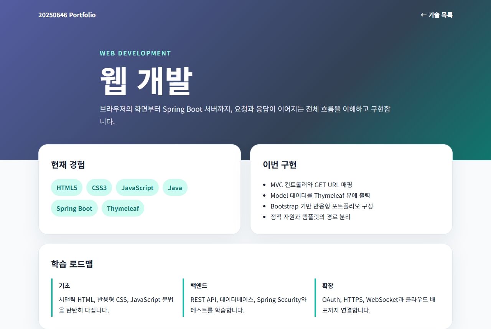
*웹 기술 상세 페이지*


## 4주차 - 데이터베이스 연동 및 테스트

4주차 데이터베이스 수정 완료

- `pom.xml`에서 Spring Data JPA, MySQL 드라이버(`mysql-connector-j`) 주석 해제
- `application.properties`에 MySQL(`localhost:3306/spring`) 접속 정보 추가, DB 계정은 git에 올라가지 않는 `application-secret.properties`로 분리(5주차에 변경)
- 계층별 패키지 구조로 변경: `controller` / `model.domain` / `model.repository` / `model.service`
- 엔티티 [TestDB.java](src/main/java/com/example/demo/model/domain/TestDB.java) → 리포지토리 [TestRepository.java](src/main/java/com/example/demo/model/repository/TestRepository.java) → 서비스 [TestService.java](src/main/java/com/example/demo/model/service/TestService.java) → 컨트롤러 `/testdb`
- 연습문제: 엔티티에 나이(`age`), 성별(`gender`) 컬럼 추가, INSERT 후 [testdb.html](src/main/resources/templates/testdb.html)에서 표로 출력
- 데이터 입력 SQL: [sql/week4_testdb.sql](sql/week4_testdb.sql)
- 테스트는 H2 메모리 DB로 실행되어 MySQL 없이도 `mvnw test` 가능


#### 실행 화면

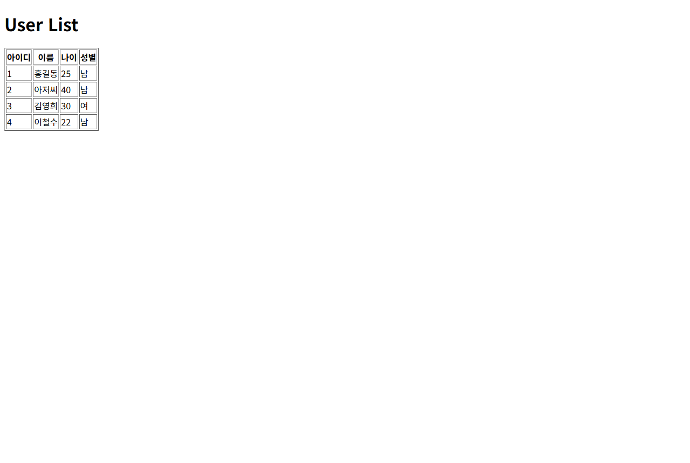
*/testdb : DB 의 testdb 테이블을 표로 출력 (연습문제 : 나이·성별 컬럼). 6주차 이후 ADMIN·MANAGER 만 접근*


### 로컬 DB 준비

1. MySQL 8 설치 (Server only, root / spring 계정 생성)
2. `create database spring;`
3. `src/main/resources/application-secret.properties` 파일을 만들고 DB 계정 2줄 작성

   ```properties
   spring.datasource.username=root
   spring.datasource.password=root비밀번호
   remember-me.key=아무거나_긴_비밀키
   ```
4. 서버 실행 → `testdb` 테이블 자동 생성 확인 → `sql/week4_testdb.sql`의 INSERT 실행
5. `http://localhost:8080/testdb` 접속

## 5주차 - 로그인/로그아웃 및 암호화

5주차 로그인/로그아웃, 암호화 완료

- `pom.xml`에 Spring Security, `thymeleaf-extras-springsecurity6` 의존성 추가
- 교수님 제공 [login.html](src/main/resources/templates/login.html), [signup.html](src/main/resources/templates/signup.html) 적용
- 직접 꾸민 포트폴리오라서 `index.html`은 전체 교체 대신 `index_네비게이션_교체부분.html`의 ①~④만 반영
  - `xmlns:sec` 선언, 로그인 사용자 표시 스타일, 모바일/PC 로그인·로그아웃 버튼, 메뉴에 `회원목록` 추가
- 새로 작성한 자바 파일 6개
  - [SecurityConfig.java](src/main/java/com/example/demo/config/SecurityConfig.java) : BCrypt 암호화 빈, URL 접근 규칙, 폼 로그인, 로그아웃
  - [MemberController.java](src/main/java/com/example/demo/controller/MemberController.java) : `/login`, `/signup` 화면과 회원가입 처리
  - [Member.java](src/main/java/com/example/demo/model/domain/Member.java) : `member` 테이블 엔티티(아이디 중복 불가, 권한 USER)
  - [MemberForm.java](src/main/java/com/example/demo/model/dto/MemberForm.java) : 회원가입 화면 데이터 DTO
  - [MemberRepository.java](src/main/java/com/example/demo/model/repository/MemberRepository.java) : `findByUsername`, `existsByUsername`
  - [MemberService.java](src/main/java/com/example/demo/model/service/MemberService.java) : 가입 시 비밀번호 BCrypt 암호화, `UserDetailsService`로 로그인 회원 조회
- 누구나 접근 : 메인, 로그인, 회원가입, 공개 실습/상세 페이지, CSS·JS·이미지
- 로그인 필요 : `/testdb`(회원목록) → 비로그인 시 로그인 화면으로 이동, 로그인 후 원래 페이지로 복귀
- 로그아웃은 CSRF 보호 때문에 POST 폼으로만 동작하고, 세션과 `JSESSIONID` 쿠키를 삭제
- DB 비밀번호가 GitHub에 노출되지 않도록 `application-secret.properties`로 분리하고 `.gitignore`에 등록
- 테스트 : 가입 시 비밀번호가 `$2a$10$...` 60자 해시로 저장되는지, 로그인 성공/실패, 로그아웃, CSRF 차단 확인 ([MemberSecurityTests.java](src/test/java/com/example/demo/MemberSecurityTests.java))


#### 실행 화면


*로그인 화면 (로그인 상태 유지 체크박스 = 연습문제 ①)*


*로그인 후 메인 : 아이디·권한 배지·로그아웃 버튼*


### 5주차 연습문제 - 로그인 기능 개선하기

- ① 로그인 상태 유지(remember-me)
  - `SecurityConfig` 로그아웃 설정 뒤에 `.rememberMe()` 추가 : `key(비밀키)`, `tokenValiditySeconds(7일)`
  - `login.html`의 `로그인 상태 유지` 체크박스(`name="remember-me"`)를 체크하고 로그인하면 7일짜리 `remember-me` 쿠키 발급
  - 브라우저를 닫아 `JSESSIONID`가 사라져도 `remember-me` 쿠키로 자동 로그인
  - 비밀키는 공개 저장소에 노출되지 않도록 `application-secret.properties`의 `remember-me.key`에 저장
- ② 비밀번호 확인 검증
  - `MemberService.signup()`에서 `password`와 `passwordConfirm` 비교
  - 다르면 "비밀번호가 일치하지 않습니다." 출력, 입력한 아이디·이름은 유지, DB에는 저장하지 않음


#### 실행 화면

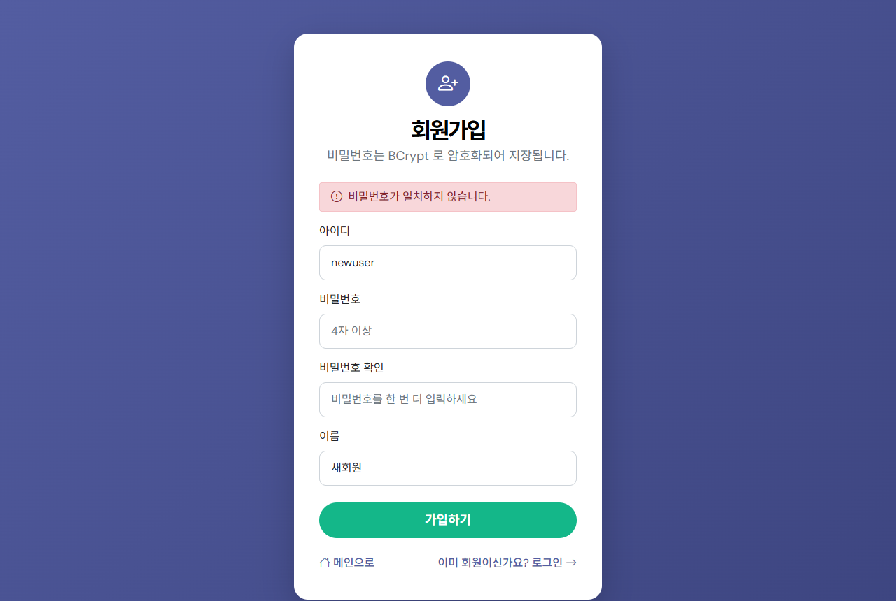
*연습문제 ② : 비밀번호 확인이 다르면 "비밀번호가 일치하지 않습니다.", 아이디·이름은 유지*


## 6주차 - 권한 관리 및 관리자 페이지

6주차 권한(ROLE) 접근 제어, 관리자 페이지 분리 완료

- 교수님 제공 화면 적용 : [mypage.html](src/main/resources/templates/mypage.html), [admin/members.html](src/main/resources/templates/admin/members.html), [error/403.html](src/main/resources/templates/error/403.html)
- 직접 꾸민 포트폴리오라서 `index.html`은 `index_네비게이션_교체부분.html`의 ①~③만 반영
  - 권한 배지 스타일, `내 정보` 메뉴(로그인 사용자), 빨간 `관리자` 메뉴(ADMIN만), 아이디 옆 권한 배지
- 자바 파일 4개
  - [AdminController.java](src/main/java/com/example/demo/controller/AdminController.java) (신규) : `/admin/members` 회원 목록, 권한 변경, 회원 삭제 (`@RequestMapping("/admin")`, PRG 패턴)
  - [SecurityConfig.java](src/main/java/com/example/demo/config/SecurityConfig.java) : `/admin/**` → `hasRole("ADMIN")`, `@EnableMethodSecurity`
  - [MemberController.java](src/main/java/com/example/demo/controller/MemberController.java) : `/mypage` (`Principal`로 로그인한 내 정보만 조회 → IDOR 차단)
  - [MemberService.java](src/main/java/com/example/demo/model/service/MemberService.java) : `findByUsername`, `findAll`, `changeRole`(ROLES 화이트리스트), `deleteMember`, `@PreAuthorize("hasRole('ADMIN')")`
- 관리자 계정 : `/signup`에서 `admin / 1234` 가입 → 제공 SQL(`UPDATE member SET role = 'ADMIN' WHERE username = 'admin'`)로 권한 부여 → 다시 로그인 (실습용 계정)
- 접근 제어 3단계 : ① 화면 `sec:authorize`(숨기기만) ② URL `requestMatchers`(1차 잠금) ③ 메서드 `@PreAuthorize`(2차 잠금)
- 결과 : 비로그인 `/admin/members` → 302 로그인 화면, USER → 403 접근 거부 화면, ADMIN → 200 회원 관리
- 테스트 : [AdminSecurityTests.java](src/test/java/com/example/demo/AdminSecurityTests.java) - 302/403/200, USER의 권한 상승 차단, 서비스 직접 호출도 `@PreAuthorize`로 차단(이중 잠금), 허용되지 않는 권한 거부, 메뉴·배지 표시


#### 실행 화면

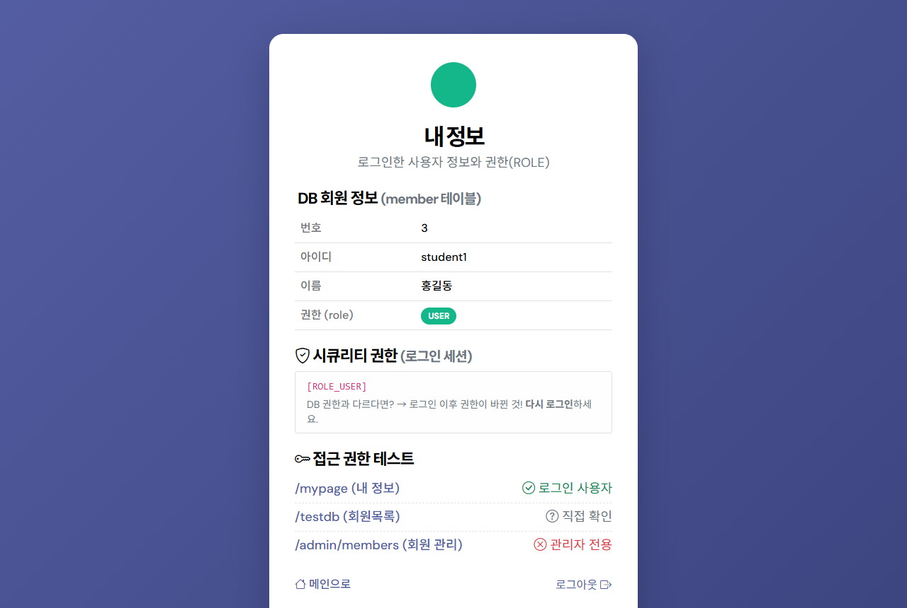
*/mypage : 로그인한 사람의 내 정보*


*ADMIN 로그인 : 관리자 메뉴·ADMIN 배지 표시*

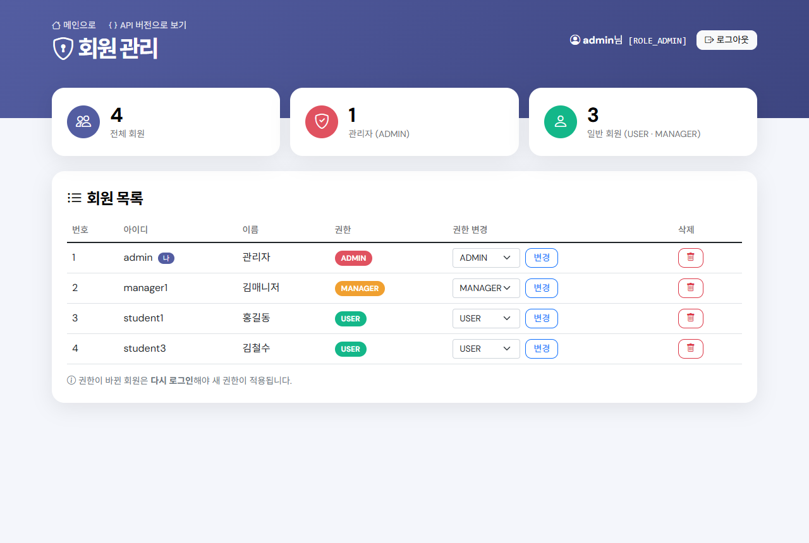
*/admin/members : 관리자 회원 관리 (권한 변경·삭제)*


*USER 가 /admin/members 접근 → 403 접근 거부 화면*


### 6주차 연습문제 - 권한 관리 개선하기

- ① 관리자 본인 보호
  - `MemberService.changeRole()`, `deleteMember()`에서 `SecurityContextHolder`로 로그인 아이디를 꺼내 대상이 본인이면 거부
  - 관리자가 자기 자신을 USER로 바꾸거나 삭제하면 "자기 자신의 권한 변경·삭제는 할 수 없습니다." 출력 → 관리자 0명 방지
- ② 매니저(MANAGER) 권한 추가
  - `ROLES` 화이트리스트에 `MANAGER` 추가 → 회원 관리에서 MANAGER 부여 가능
  - `SecurityConfig`에 `.requestMatchers("/testdb").hasAnyRole("ADMIN", "MANAGER")` 추가

  | 주소 | USER | MANAGER | ADMIN |
  |---|---|---|---|
  | `/mypage` | ✓ | ✓ | ✓ |
  | `/testdb` (회원목록) | 403 | ✓ | ✓ |
  | `/admin/**` (회원 관리) | 403 | 403 | ✓ |
- 추가 도전 : `index.html`의 회원목록 메뉴에 `sec:authorize="hasAnyRole('ADMIN', 'MANAGER')"` → USER에게는 메뉴도 숨김

## 7주차 - REST API와 JSON

7주차 회원 관리 REST API(JSON) 완료

- 교수님 제공 화면 적용 : [admin/members-api.html](src/main/resources/templates/admin/members-api.html) (fetch 로 API 호출, 오른쪽 기록창), [admin/members.html](src/main/resources/templates/admin/members.html)에 "API 버전으로 보기" 링크
- 자바 파일
  - [MemberApiController.java](src/main/java/com/example/demo/controller/MemberApiController.java) (신규) : `GET /api/hello`(누구나), `GET /api/me`(로그인한 내 정보)
  - [MemberResponse.java](src/main/java/com/example/demo/model/dto/MemberResponse.java) (신규) : 응답 DTO(record) → id, username, name, role 만 내보내고 password(해시)는 숨김
  - [RoleRequest.java](src/main/java/com/example/demo/model/dto/RoleRequest.java) (신규) : 권한 변경 요청 본문 `{"role": "ADMIN"}`
  - [AdminApiController.java](src/main/java/com/example/demo/controller/AdminApiController.java) (신규) : `/api/admin/members` 목록·1명 조회·등록·권한 변경·삭제 (`ResponseEntity`로 상태 코드 지정)
  - [SecurityConfig.java](src/main/java/com/example/demo/config/SecurityConfig.java) : `/api/hello` 허용, `/api/admin/**` ADMIN 전용, `httpBasic()`, `/api/**` CSRF 제외, 로그인 안 한 API 요청은 302 대신 401
  - [MemberService.java](src/main/java/com/example/demo/model/service/MemberService.java) : `findById`, 회원가입 빈 값 검사, `changeRole()`이 바뀐 회원을 반환
  - [AdminController.java](src/main/java/com/example/demo/controller/AdminController.java) : `/admin/members-api` 화면
- 인증 : 브라우저는 로그인 세션 쿠키, Postman은 요청마다 Basic 인증(아이디:비밀번호) → 같은 API, 같은 결과

  | 메서드 · 주소 | 하는 일 | 결과 |
  |---|---|---|
  | `GET /api/admin/members` | 회원 목록 | 200 (비밀번호 없음), USER → 403 |
  | `GET /api/admin/members/{id}` | 회원 1명 | 200, 없으면 404 |
  | `POST /api/admin/members` | 회원 등록 | 201 + Location, 중복·빈 값 400, `role` 몰래 넣어도 USER |
  | `PATCH /api/admin/members/{id}/role` | 권한 변경 | 200, `SUPER` 400, 본인 변경 400 |
  | `DELETE /api/admin/members/{id}` | 회원 삭제 | 204 |
- 테스트 : [RestApiTests.java](src/test/java/com/example/demo/RestApiTests.java) - Basic 인증으로 401/200/201/204/400/403/404, 응답에 password 없음, 제공 화면 연결
  - `httpBasic()` 추가 후 Accept 헤더 없는 요청은 401이 되므로, 기존 302 테스트는 브라우저처럼 `Accept: text/html`을 보내도록 수정


#### 실행 화면

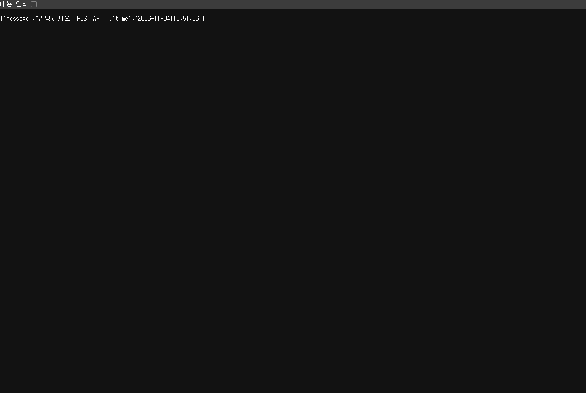
*GET /api/hello : 누구나 (JSON)*

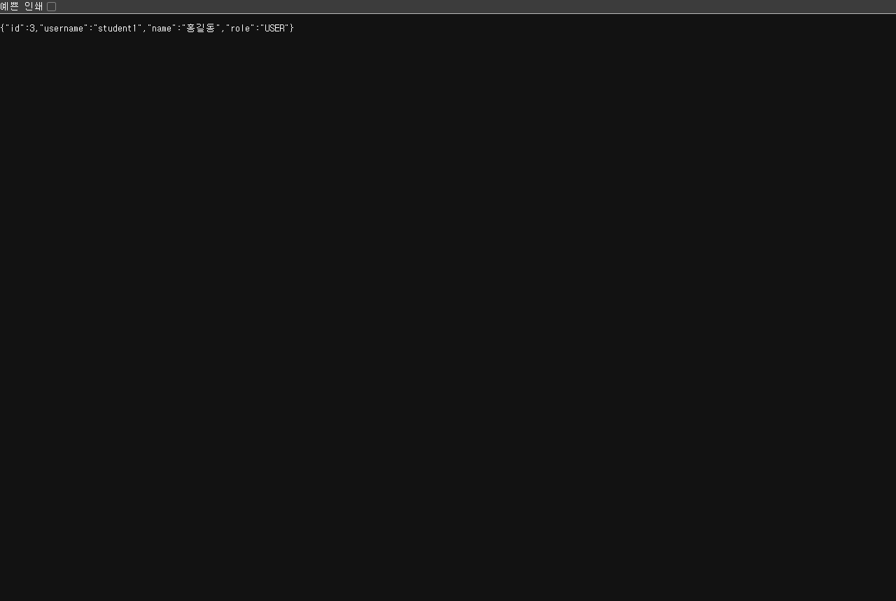
*GET /api/me : 로그인한 내 정보 (비밀번호 없음)*

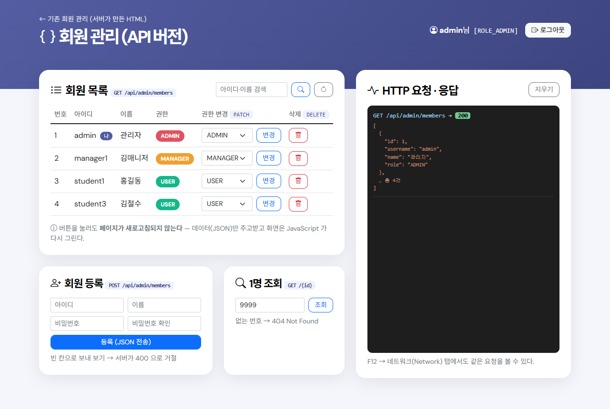
*/admin/members-api : fetch 로 JSON API 호출, 오른쪽에 요청·응답 기록*


### 7주차 연습문제 - REST API 개선하기

- ① 회원 검색 API : `GET /api/admin/members?keyword=student`
  - `@RequestParam(required = false) String keyword` → 검색어가 없으면 전체 목록, 있으면 검색
  - [MemberRepository.java](src/main/java/com/example/demo/model/repository/MemberRepository.java) : `findByUsernameContainingOrNameContainingOrderByIdAsc` → 아이디나 이름에 검색어가 들어간 회원만
  - 확인 : 제공 화면(`/admin/members-api`) 검색창에 `student` → student1 만 출력
- ② 오류 처리 한 곳에 모으기 : [ApiExceptionHandler.java](src/main/java/com/example/demo/controller/ApiExceptionHandler.java) (신규)
  - `@RestControllerAdvice(annotations = RestController.class)` → JSON API 컨트롤러에만 적용
  - `IllegalArgumentException` → 400 `{"error": "..."}` : 등록·권한 변경·삭제의 반복되던 try-catch 제거, 지운 뒤에도 상태 코드·본문 동일
  - JSON 형식 오류(`HttpMessageNotReadableException`) → 400 `{"error": "요청 JSON 형식이 올바르지 않습니다."}` : trace(서버 내부 정보) 숨김
- 테스트 : [RestApiTests.java](src/test/java/com/example/demo/RestApiTests.java) - 검색 결과, 서비스 오류 400, 잘못된 JSON에 trace 없음


#### 실행 화면

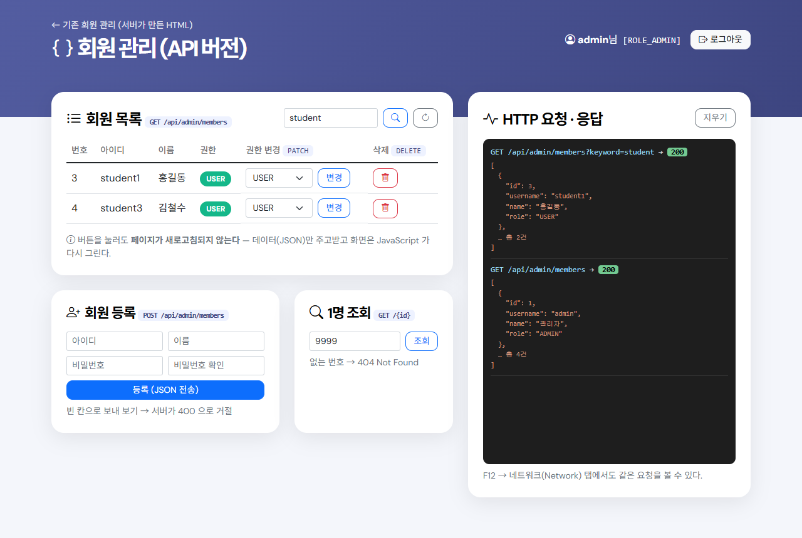
*연습문제 ① : 검색창에 student → GET /api/admin/members?keyword=student*


## 9주차 - 게시판 CRUD와 본인 확인

9주차 게시판(CRUD) + 본인 확인 완료

- 교수님 제공 화면 적용 : [board/list.html](src/main/resources/templates/board/list.html), [board/detail.html](src/main/resources/templates/board/detail.html), [board/form.html](src/main/resources/templates/board/form.html)(글쓰기·수정 공용, `postId` 유무로 구분), [error/404.html](src/main/resources/templates/error/404.html), [board.css](src/main/resources/static/css/board.css), [index.html](src/main/resources/templates/index.html)에 "게시판" 메뉴만 추가
- 자바 파일
  - [Post.java](src/main/java/com/example/demo/model/domain/Post.java) (신규) : `posts` 테이블, 작성자 `@ManyToOne(fetch = LAZY)` + `@JoinColumn(name = "member_id")` (FK → member.id)
  - [PostForm.java](src/main/java/com/example/demo/model/dto/PostForm.java) (신규) : 제목·내용만 받음 → 작성자 바꿔치기 방지
  - [PostRepository.java](src/main/java/com/example/demo/model/repository/PostRepository.java) (신규) : `JpaRepository<Post, Long>`
  - [PostService.java](src/main/java/com/example/demo/model/service/PostService.java) (신규) : 목록(최신순)·글쓰기(작성자 = 로그인 회원)·상세(없으면 404)·수정·삭제, `checkWriter()`·`isAdmin()` 본인 확인
  - [BoardController.java](src/main/java/com/example/demo/controller/BoardController.java) (신규) : `/board` 목록, `/board/{id}` 상세, `/board/write`, `/board/{id}/edit`, `/board/{id}/delete`, `/board/my`(연습문제)
  - [SecurityConfig.java](src/main/java/com/example/demo/config/SecurityConfig.java) : `.requestMatchers("/board", "/board/{id:\d+}").permitAll()` → 목록·상세만 누구나, 나머지는 로그인

  | 주소 | 비로그인 | 글쓴이 | 다른 USER | ADMIN |
  |---|---|---|---|---|
  | `GET /board`, `/board/{id}` | ✓ | ✓ | ✓ | ✓ |
  | `/board/write`, `/board/my` (연습문제) | 로그인 화면 | ✓ | ✓ | ✓ |
  | `/board/{id}/edit` | 로그인 화면 | ✓ | 403 | 403 (수정은 본인만) |
  | `POST /board/{id}/delete` | 로그인 화면 | ✓ | 403 | ✓ (관리자 삭제) |
- 테스트 : [BoardTests.java](src/test/java/com/example/demo/BoardTests.java) (14개) - 비로그인 목록·글쓰기 차단, 작성자 자동 지정, 빈 제목 오류, CSRF 403, 없는 글 404, 본인 수정·삭제, 남의 글 수정·삭제 403, 관리자 삭제 가능·수정 403, 연습문제(조회수, 내가 쓴 글)

### 9주차 정리

강의 PDF(28쪽) 기준으로 정리한 내용

#### 1. 오늘의 핵심 한 줄

> 게시판 = **CRUD** + **작성자 연결** + **본인 확인**. 버튼을 숨기는 것만으로는 막을 수 없고, **서버가 "이 글의 작성자가 맞나?"를 직접 확인**해야 한다.

#### 2. 왜 게시판에 보안이 필요한가

- 위협 : 주소의 번호만 바꿔 남의 글을 수정·삭제 (`/board/2/edit`) → 7주차 OWASP **A01 접근 제어 실패**와 같은 유형
- 6주차 : 관리자 메뉴만 숨겼더니 주소로 들어갔다 → 9주차 : 수정 버튼만 숨기면 주소로 들어간다

| 주차 | 기준 | 질문 | 실패 예 |
|---|---|---|---|
| 5주차 | 로그인 | 누구세요? | 비로그인 → 로그인 화면 |
| 6주차 | 역할(ROLE) | 관리자인가요? | USER → 관리자 페이지 403 |
| 9주차 | 주인(작성자) | 이 글을 쓴 사람인가? | 남의 글 수정 → 403 |

#### 3. 실습 순서

1. 제공 화면 복사 : `templates/board/`(목록·상세·글쓰기/수정 공용), `templates/error/404.html`, `static/css/board.css`, `index.html`에 "게시판" 메뉴
   - 직접 꾸민 학생은 **게시판 메뉴 추가 부분만** 반영 (index.html 전체를 덮어쓰지 않기)
2. 글 엔티티(작성자 연결) → `Post.java`
3. DTO·리포지토리 → `PostForm.java`, `PostRepository.java`
4. 글쓰기·목록 → `PostService`, `BoardController`, `SecurityConfig`
5. 상세 보기 + 404
6. 수정·삭제 (문제 : 남의 글도 고쳐진다!)
7. 본인 확인 (`checkWriter`, `isAdmin`)

##### 화면 ↔ 컨트롤러 약속

| 화면 | 주소 | 컨트롤러가 넘겨줄 값 |
|---|---|---|
| `board/list.html` | `GET /board` | `posts` (글 목록, "전체 N개"도 이 크기) |
| `board/detail.html` | `GET /board/{id}` | `post` (글 1개) |
| `board/form.html` | `GET /board/write`, `/board/{id}/edit` | `postForm`(입력값), `postId`(수정일 때), `error` |

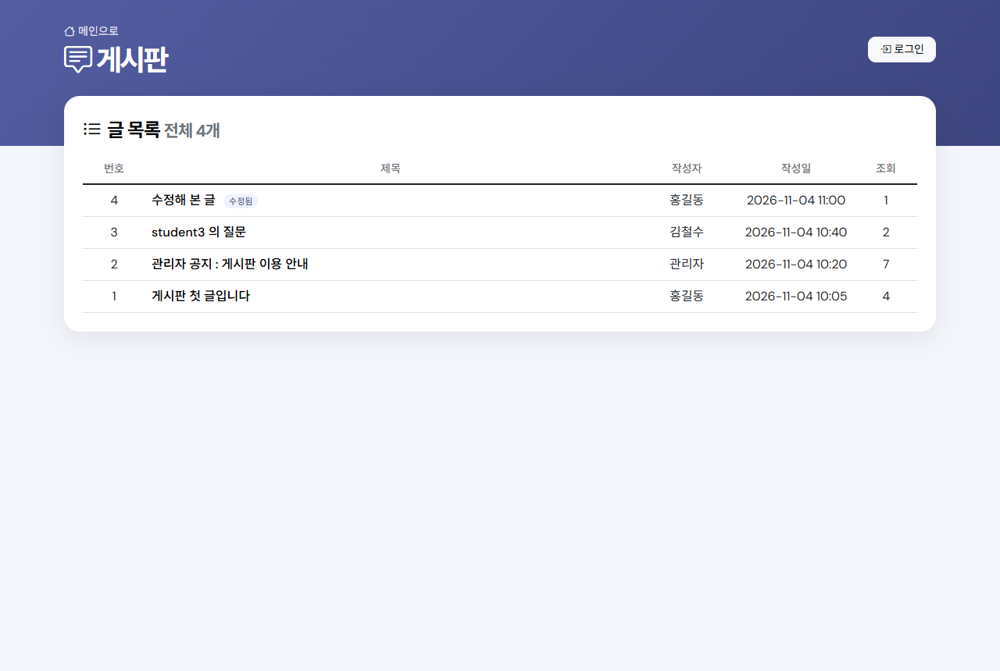
*비로그인 게시판 목록 : 글쓰기 버튼 없음*

#### 4. CRUD와 JPA, 주소

| 기능 | SQL | JPA | 화면 주소 (오늘) | 7주차 REST라면 |
|---|---|---|---|---|
| 쓰기 (Create) | INSERT | `save()` | `POST /board/write` | `POST /api/posts` |
| 목록 (Read) | SELECT | `findAll()` | `GET /board` | `GET /api/posts` |
| 상세 (Read) | SELECT … WHERE id | `findById()` | `GET /board/3` | `GET /api/posts/3` |
| 수정 (Update) | UPDATE | `save()` | `POST /board/3/edit` | `PATCH /api/posts/3` |
| 삭제 (Delete) | DELETE | `delete()` | `POST /board/3/delete` | `DELETE /api/posts/3` |

- **HTML 폼은 GET·POST만** 보낼 수 있다 → PATCH·DELETE 대신 주소 끝에 할 일(`/edit`, `/delete`)을 붙인다
- 목록·상세 : 누구나(GET) / 쓰기·수정·삭제 : 로그인한 사람(폼 → POST)

#### 5. 글 엔티티와 작성자 연결 (`@ManyToOne`)

```java
@Entity
@Table(name = "posts")
@Data
public class Post {
    @Id @GeneratedValue(strategy = GenerationType.IDENTITY)
    private Long id;
    @Column(nullable = false, length = 100)
    private String title;
    @Column(nullable = false, columnDefinition = "TEXT")
    private String content;
    @ManyToOne(fetch = FetchType.LAZY)              // 글 N : 회원 1
    @JoinColumn(name = "member_id", nullable = false) // FK 컬럼 이름
    private Member author;
    @Column(nullable = false)
    private LocalDateTime createdAt;
    private LocalDateTime updatedAt;                 // 수정한 적 없으면 null
    @Column(nullable = false)
    private int viewCount = 0;                       // 연습문제에서 사용
}
```

| 시점 | 읽는 법 | 어노테이션 | 붙는 위치 |
|---|---|---|---|
| 회원에서 보면 | 회원 1명 → 글 여러 개 (1 : N) | `@OneToMany` | Member |
| 글에서 보면 | 글 여러 개 → 회원 1명 (N : 1) | `@ManyToOne` | Post |

- 게시글(Post) 기준으로 읽으므로 **N : 1 = `@ManyToOne`**

**작성자를 왜 문자열이 아니라 객체로?**

| 문제 | `String writer = "student1"` | `Member author + @ManyToOne` |
|---|---|---|
| 작성자 이름 보기 | 회원을 다시 찾아야 함 | `post.author.name` 한 번에 |
| 회원 정보가 바뀌면 | 글 쪽 값과 어긋남 | 항상 최신 회원 정보 |
| 없는 회원 이름 입력 | 막을 수 없음 | DB의 FK가 막아 줌 |
| 회원 삭제 시 | 주인 없는 글이 남음 | FK 때문에 오류 → 처리 필요(10주차) |

**DB 테이블 매핑**

| 자바 필드 | DB 컬럼 | 타입 |
|---|---|---|
| id | id | bigint (자동 증가, PK) |
| title | title | varchar(100) |
| content | content | TEXT |
| author | member_id | bigint (FK → member.id) |
| createdAt / updatedAt | created_at / updated_at | datetime |
| viewCount | view_count | int |

- **외래 키(FK) = DB가 지키는 약속** : `member_id`는 반드시 존재하는 회원 번호
- **`FetchType.LAZY`** : 연결된 객체를 바로 읽지 않고 필요할 때 가져온다 (불필요한 조회 감소)

#### 6. DTO · 리포지토리

```java
@Data
public class PostForm {   // 화면 → 컨트롤러
    private String title;    // input name="title"
    private String content;  // textarea name="content"
    // 작성자는 받지 않는다 → 로그인한 사람으로 서버가 정한다
}

@Repository
public interface PostRepository extends JpaRepository<Post, Long> { }
// save, findAll, findById, delete 는 이미 있다
```

| 구분 | MemberForm (5주차) | PostForm (9주차) |
|---|---|---|
| 받는 값 | 아이디, 비밀번호, 확인, 이름 | 제목, 내용 |
| 받지 않는 값 | role (권한) | author (작성자) |
| 막는 것 | 권한 조작 | 작성자 바꿔치기 (남의 이름으로 글쓰기) |

#### 7. 글쓰기 · 목록

**글쓰기 순서 : ① 검사 → ② 작성자 찾기 → ③ 저장**

```java
public List<Post> findAll() {                     // 최신 글이 위로
    return postRepository.findAll(Sort.by(Sort.Direction.DESC, "id"));
}

public Post write(PostForm form, String username) {
    validate(form);                                // ① 빈 값·100자 검사
    Member author = memberRepository.findByUsername(username)
            .orElseThrow(() -> new IllegalArgumentException("회원이 존재하지 않습니다."));
    Post post = new Post();
    post.setTitle(form.getTitle().trim());
    post.setContent(form.getContent());
    post.setAuthor(author);                        // ② 작성자는 서버가 정한다
    post.setCreatedAt(LocalDateTime.now());
    return postRepository.save(post);              // ③ INSERT
}
```

- 컨트롤러 : `principal.getName()` = 로그인한 아이디 → 작성자. 성공하면 `redirect:/board/{id}`, `IllegalArgumentException`이면 `error`를 담아 같은 폼 다시 표시
- `SecurityConfig`

```java
.requestMatchers("/board", "/board/{id:\\d+}").permitAll() // 목록·상세 : 누구나
```

- `{id:\d+}` = 숫자만 → `/board/write`는 포함 안 됨 (로그인 필요)
- `/board/**`로 넓게 허용하면 글쓰기까지 누구나 열려 버린다

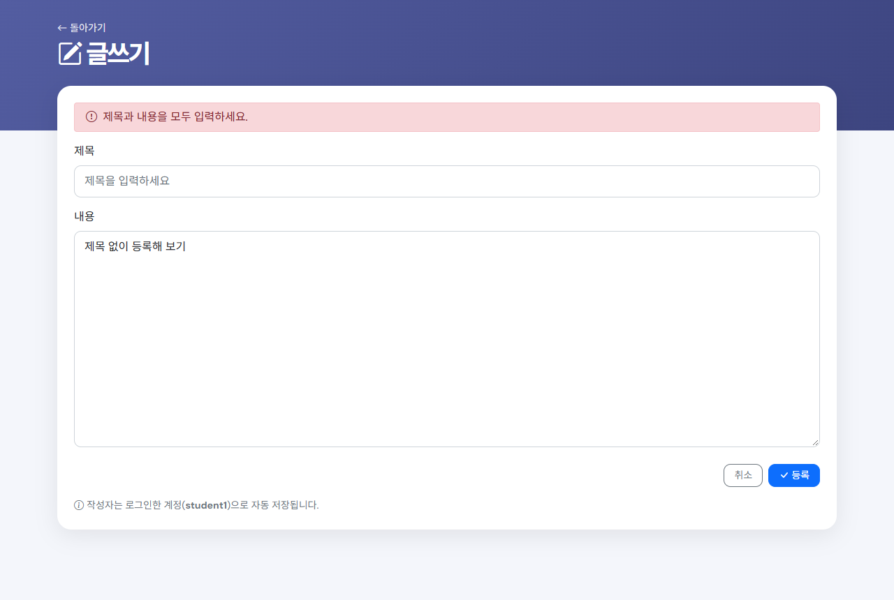
*제목을 비우고 등록 → "제목과 내용을 모두 입력하세요."*

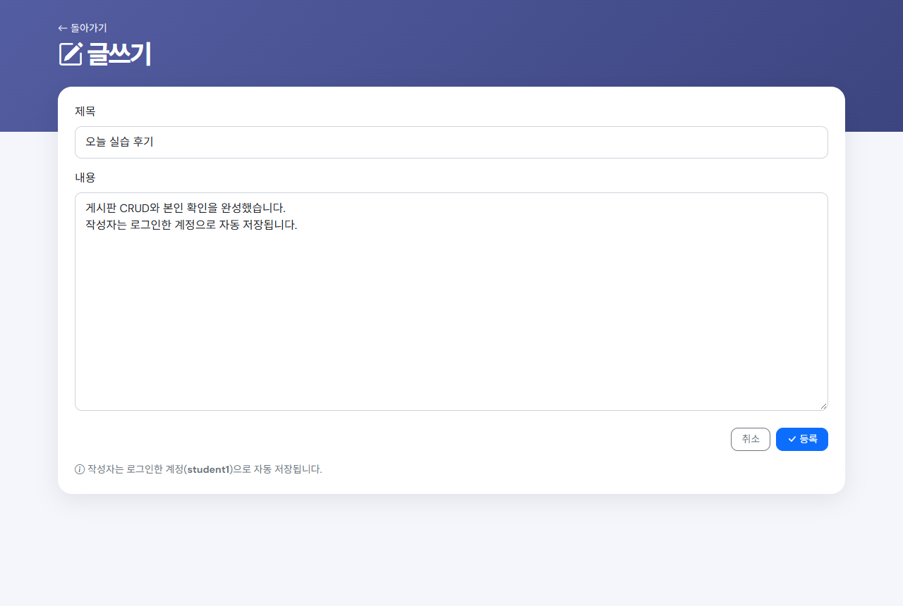
*student1 글쓰기 화면 (작성자는 로그인 계정으로 자동 저장)*

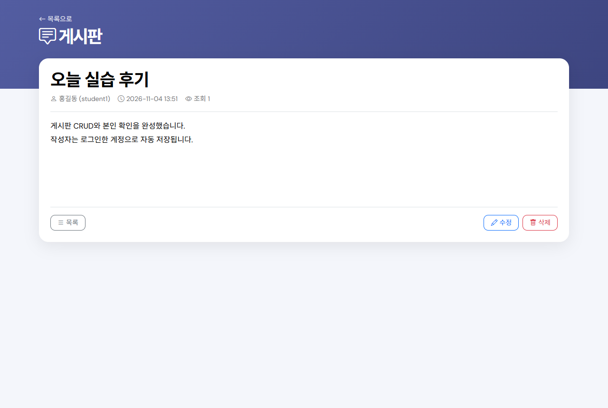
*등록 후 상세 화면 : 글쓴이에게만 수정·삭제 버튼*

#### 8. 상세 보기와 404

```java
public Post findById(Long id) {
    return postRepository.findById(id)
            .orElseThrow(() -> new ResponseStatusException(HttpStatus.NOT_FOUND, "글이 존재하지 않습니다."));
}
```

- `ResponseStatusException(NOT_FOUND)` → 스프링 부트가 `templates/error/404.html`을 자동으로 보여 줌 (6주차 `error/403.html`과 같은 방식)
- 상세 화면은 `th:text`로 내용 출력 → HTML 태그가 글자로 보인다 (XSS 방지)

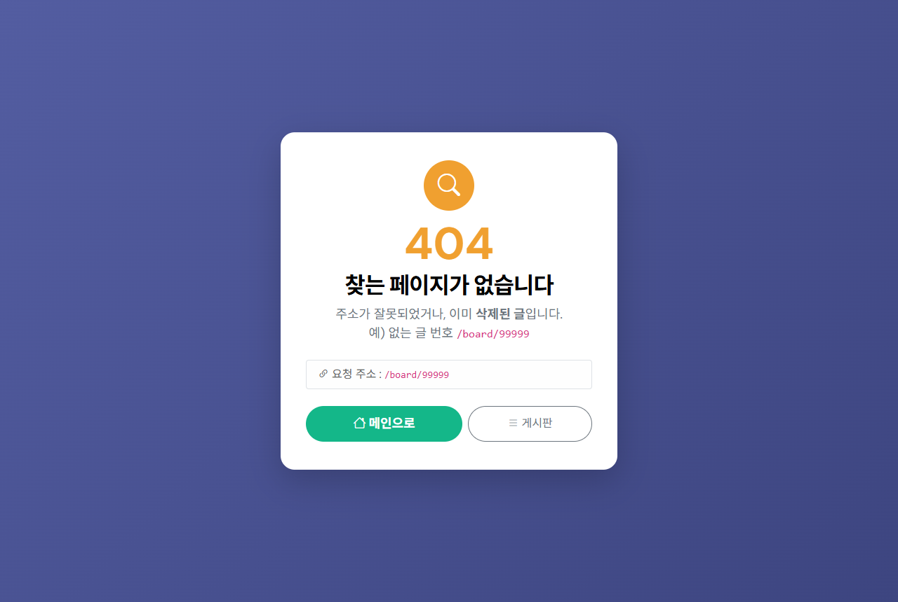
*없는 글 /board/99999 → 404 화면*

#### 9. 수정 · 삭제

- JPA에는 별도의 "수정 메서드"가 없다 → 조회한 엔티티 값을 바꾸고 `save()` (변경 감지, Dirty Checking)

| 상황 | post의 id | `save()`가 하는 일 |
|---|---|---|
| 글쓰기 (write) | 없음 (null) | INSERT |
| 수정 (edit) | 있음 | UPDATE |

```java
public Post edit(Long id, PostForm form) {
    Post post = findForEdit(id);
    validate(form);
    post.setTitle(form.getTitle().trim());
    post.setContent(form.getContent());
    post.setUpdatedAt(LocalDateTime.now());  // 수정 시간 기록
    return postRepository.save(post);        // UPDATE
}
```

**글쓰기·수정 화면 하나로 쓰기 (form.html)**

| 구분 | 글쓰기 | 수정 |
|---|---|---|
| postId | 없음 | 글 번호 |
| 폼 전송 주소 | `POST /board/write` | `POST /board/{id}/edit` |
| 입력칸 | 빈 칸 | 기존 제목·내용 채움 |

- 삭제 후 `redirect:/board?deleted` → 목록에 "글이 삭제되었습니다."

**문제 발견 (단계 5 테스트)** : student3이 student1의 글에서 버튼은 안 보이지만, 주소창에 `/board/2/edit`을 치면 수정 화면이 열리고 저장까지 된다 → 버튼은 숨겼지만 **서버는 확인하지 않았다**.

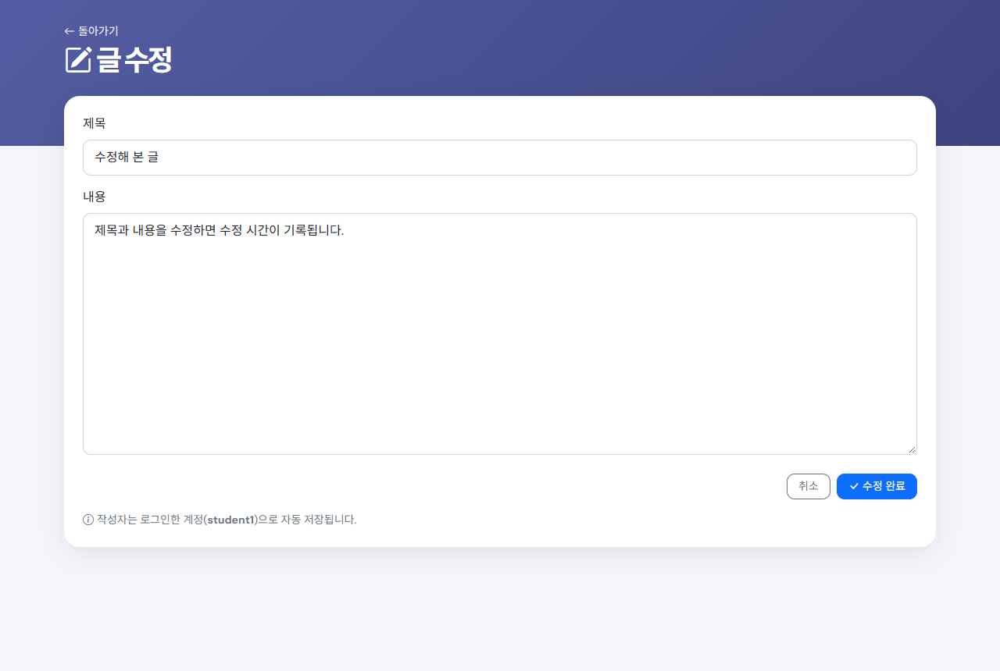
*수정 화면 : 기존 제목·내용이 채워진 form.html (postId 있음)*

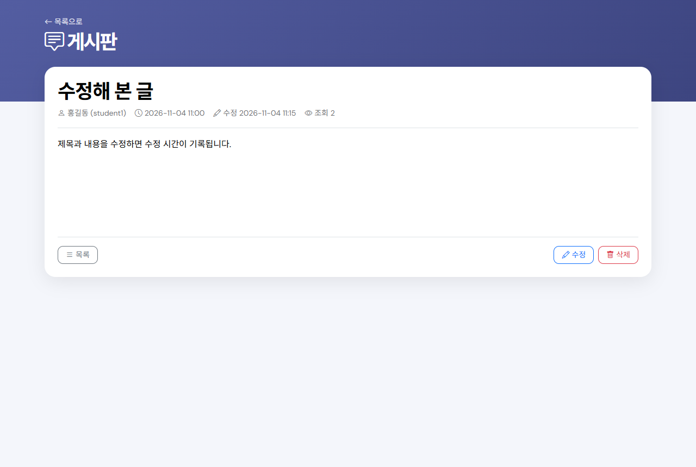
*수정 후 상세 : "수정 시간" 표시, 목록에는 "수정됨" 배지*

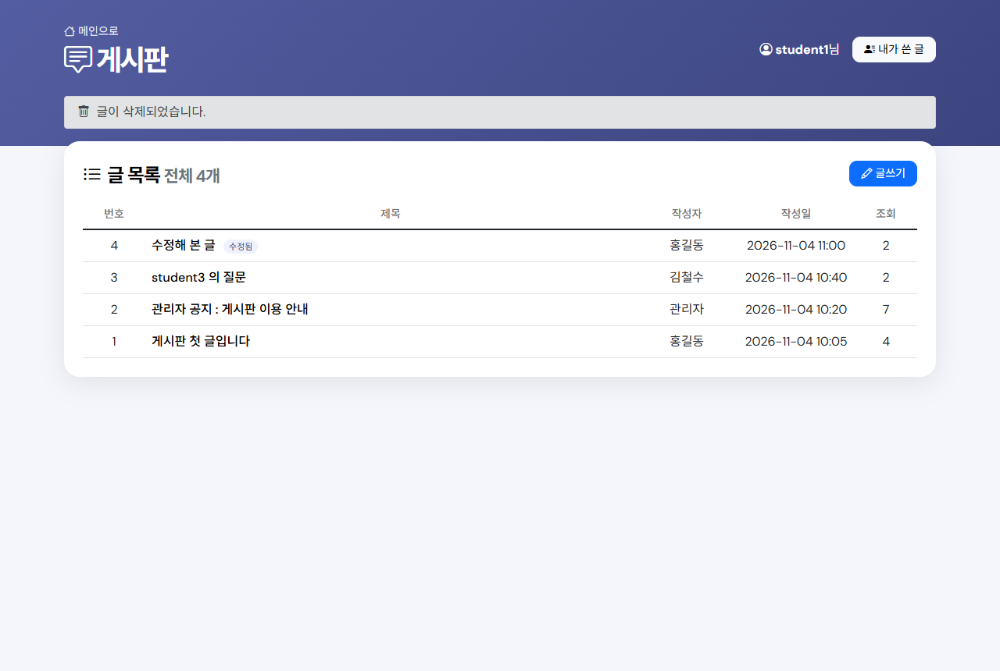
*삭제 후 목록 : "글이 삭제되었습니다."*

#### 10. 본인 확인 (핵심)

- 서버가 확인할 것 : **로그인한 사람 = 글쓴이?** 다르면 `AccessDeniedException` → 403 화면
- 관리자 규칙 : **수정은 본인만**(대신 고치면 안 됨), **삭제는 본인 또는 관리자**(규칙 위반 글 정리)
- URL 규칙으로 못 하는 이유 : `/board/2/edit`의 주인은 **DB를 봐야 안다** → 서비스 코드에서 확인

```java
public Post findForEdit(Long id) {          // 수정 화면·수정 처리 모두 여기를 지난다
    Post post = findById(id);
    checkWriter(post);                      // ★ 본인만
    return post;
}

public void delete(Long id) {
    Post post = findById(id);
    if (!isAdmin()) checkWriter(post);      // ★ 관리자는 누구 글이든 삭제 가능
    postRepository.delete(post);
}

private void checkWriter(Post post) {
    String loginUsername = SecurityContextHolder.getContext().getAuthentication().getName();
    if (!post.getAuthor().getUsername().equals(loginUsername)) {
        throw new AccessDeniedException("본인이 쓴 글만 수정·삭제할 수 있습니다.");
    }
}

private boolean isAdmin() {
    Authentication auth = SecurityContextHolder.getContext().getAuthentication();
    return auth.getAuthorities().stream().anyMatch(a -> a.getAuthority().equals("ROLE_ADMIN"));
}
```

- `edit()`은 `findForEdit()`을 부르므로 **자동으로 본인 확인**된다
- **이중 확인** = 화면(버튼 숨김, 1차 안내) + 서비스(본인 확인, 진짜 검사)

| 구분 | 6주차 관리자 페이지 | 9주차 게시글 |
|---|---|---|
| 기준 | 역할 (ROLE_ADMIN) | 주인 (글쓴이) |
| 확인 위치 | URL 규칙 + `@PreAuthorize` | 서비스 코드 (글마다 주인이 다름) |
| 화면 | 관리자 메뉴 숨김 | 수정·삭제 버튼 숨김 |
| 실패 시 | 403 | 403 |

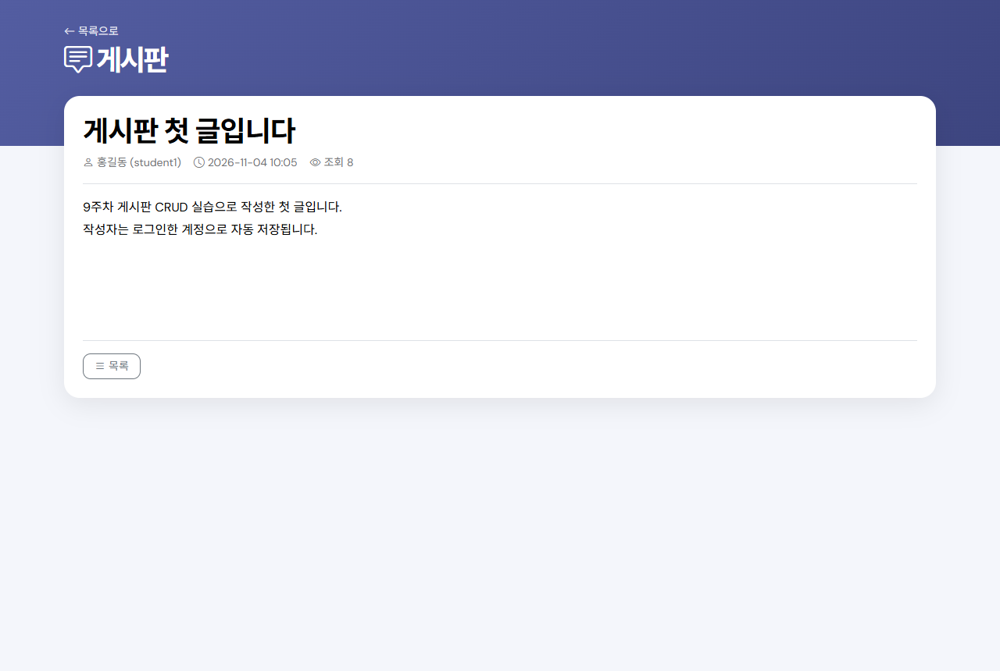
*student3 이 student1 의 글을 열면 수정·삭제 버튼이 없다*


*student3 이 주소창에 /board/1/edit 입력 → 403 (서버의 본인 확인)*

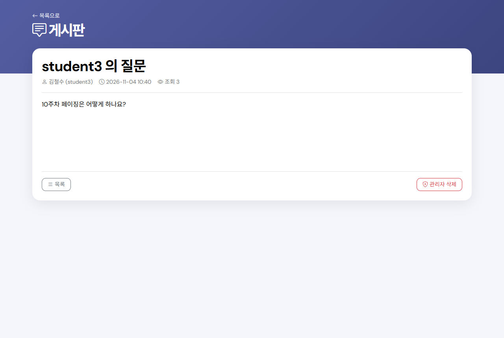
*admin 이 student3 의 글을 열면 "관리자 삭제" 버튼*

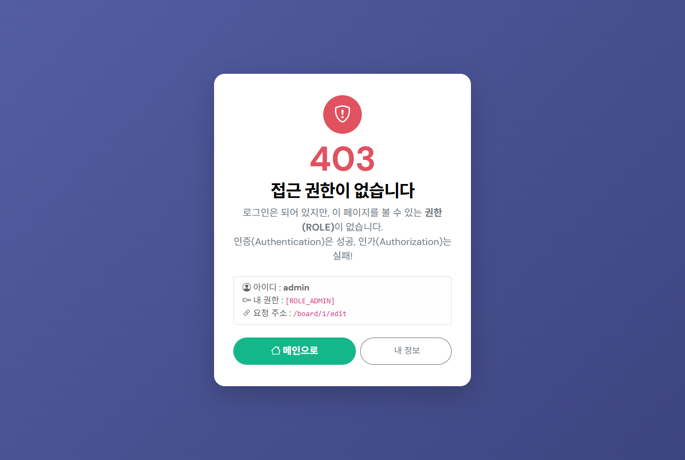
*admin 이라도 남의 글 수정은 403 (수정은 본인만)*

#### 11. 테스트 표 (직접 확인 + `BoardTests.java` 자동 테스트)

| # | 계정 | 하는 일 | 기대 결과 |
|---|---|---|---|
| 1 | 로그인 안 함 | 메인 → 게시판 | 목록, 글쓰기 버튼 없음 |
| 2 | 로그인 안 함 | 주소창 `/board/write` | 로그인 화면 |
| 3 | student1 | 글쓰기 → 등록 | 상세 화면 |
| 4 | student1 | 제목 비우고 등록 | "제목과 내용을 모두 입력하세요." |
| 5 | 누구나 | `/board/99999` | 404 화면 |
| 6 | student1 | 내 글 수정 | 수정됨, "수정 시간" 표시 |
| 7 | student1 | 내 글 삭제 | 목록 + "글이 삭제되었습니다." |
| 8 | student3 | student1 글 열기 | 수정·삭제 버튼 없음 |
| 9 | student3 | 주소창 `/board/2/edit` | **403** |
| 10 | admin | student3 글 열기 → 관리자 삭제 | 삭제됨 |
| 11 | admin | student1 글 `/edit` | **403** (수정은 본인만) |

#### 12. 오류 해결표

| 증상 | 원인 → 해결 |
|---|---|
| 게시판 목록이 로그인 화면으로 | `/board` permitAll 누락 |
| 글쓰기 저장 시 403 | 폼에 `th:action` 대신 `action` 사용 → CSRF 토큰 없음 (5주차) |
| `/board/write`가 누구에게나 열림 | `/board/**`로 너무 넓게 허용 → `{id:\d+}` 사용 |
| 글 제목 클릭 시 404 | 상세 미구현, 또는 없는 번호 |
| 남의 글이 수정됨 | `checkWriter()` 누락 |
| 글 쓴 회원을 관리자가 삭제하면 500 | 외래 키 때문 → 10주차에 해결, 지금은 그 회원의 글을 먼저 삭제 |
| (내 경우) 메인 화면 링크·회원목록 메뉴 숨김이 사라짐 | 제공 `index.html` 전체로 덮어씀 → 기존 파일에 게시판 메뉴 부분만 추가 |

#### 13. 시험 대비 체크

- CRUD 각각의 SQL, JPA 메서드, 오늘의 주소를 말할 수 있는가?
- HTML 폼으로 수정·삭제를 POST로 하는 이유는? (폼은 GET·POST만)
- `@ManyToOne`인 이유와 `@JoinColumn(name = "member_id")`의 의미는?
- `FetchType.LAZY`란?
- PostForm에 author를 받지 않는 이유는? (작성자 바꿔치기 방지)
- `{id:\d+}`를 쓰는 이유는?
- `save()`가 INSERT/UPDATE를 구분하는 기준은? (id 유무)
- 버튼 숨김만으로 안 되는 이유와 본인 확인 위치는? (서비스, DB의 주인 확인)
- 수정과 삭제의 관리자 규칙 차이는?
- 깃에는 코드만 올라가고, 오늘 쓴 글(데이터)은 DB에 저장된다

### 9주차 연습문제 - 조회수 & 내가 쓴 글 모아 보기

- ① 조회수 : 상세 화면을 열 때마다 `viewCount` 1 증가
  - [PostService.java](src/main/java/com/example/demo/model/service/PostService.java) : `read(id)` → `findById()` 후 `viewCount + 1` → `save()` (id 가 있으니 UPDATE)
  - [BoardController.java](src/main/java/com/example/demo/controller/BoardController.java) : `detail()`에서 `findById()` 대신 `read()` 사용
  - 수정 화면(`findForEdit`)은 조회수를 올리지 않는다 → 상세 보기만 "조회"
  - 확인 : 같은 글 상세를 3번 열기 → 조회 3 (목록·상세의 조회 숫자)
- ② 내가 쓴 글 모아 보기 : `GET /board/my` → 로그인한 사람의 글만, 최신 글이 위로
  - [PostRepository.java](src/main/java/com/example/demo/model/repository/PostRepository.java) : 메서드 이름만 추가 `findByAuthor_UsernameOrderByIdDesc(String username)`

    | 이름 조각 | 뜻 | SQL 로 바꾸면 |
    |---|---|---|
    | `findBy` | 찾아라 | `SELECT … FROM posts` |
    | `Author_Username` | 작성자(author)의 username 으로 | `JOIN member … WHERE m.username = ?` |
    | `OrderByIdDesc` | 번호 큰 순서(최신 글)로 | `ORDER BY p.id DESC` |
  - `PostService.findMyPosts(username)`, `BoardController.myPosts()` : `principal.getName()`으로 로그인 아이디를 꺼내 조회
  - 목록 화면 `board/list.html` 재사용, `listTitle`에 "내가 쓴 글"을 넘겨 제목만 변경
  - `SecurityConfig`는 수정하지 않음 : `/board/{id:\d+}`는 숫자만 허용하므로 `/board/my`는 `anyRequest().authenticated()`에 걸려 로그인 필요
  - `@GetMapping("/my")`는 고정 주소라서 `@GetMapping("/{id}")`보다 먼저 연결된다

  | # | 하는 일 | 기대 결과 | 결과 |
  |---|---|---|---|
  | ① | 같은 글 상세를 3번 열기 | 조회 3 | ✓ |
  | ② | student1 로그인 → 내가 쓴 글 | student1 의 글만, 제목 "내가 쓴 글" | ✓ |
  | ② | 로그인 안 하고 `/board/my` | 로그인 화면 | ✓ |

#### 실행 화면

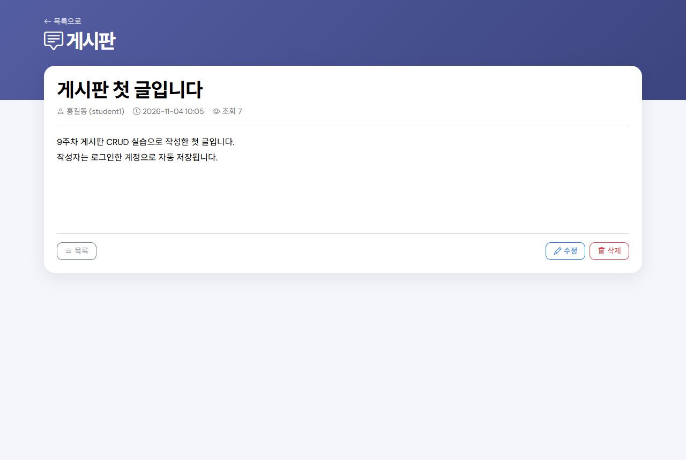
*① 상세를 열 때마다 조회수 증가*

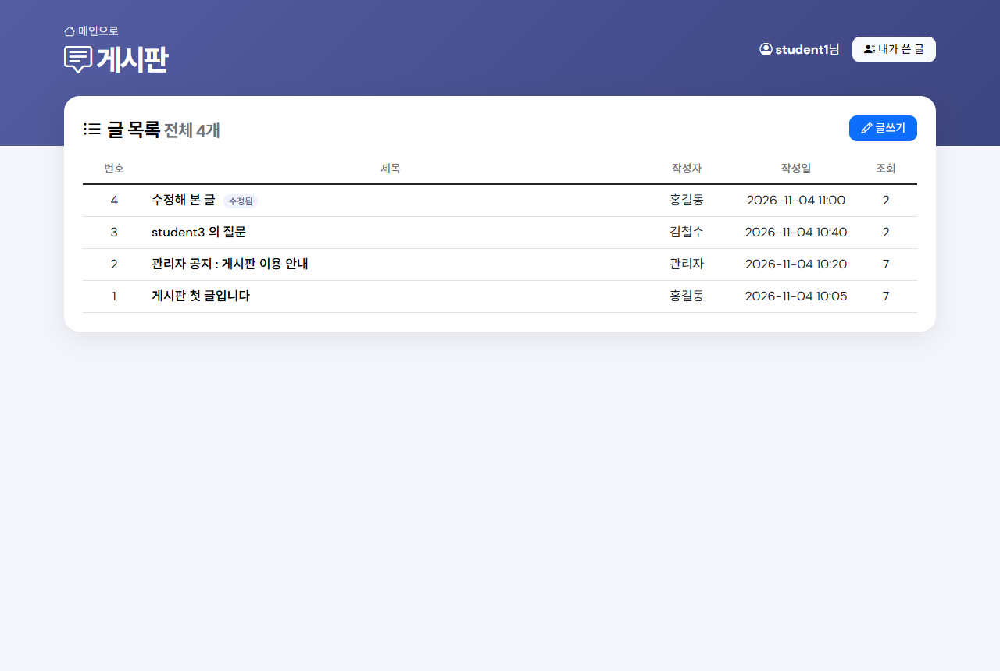
*① 목록의 조회 칸에도 같은 숫자*

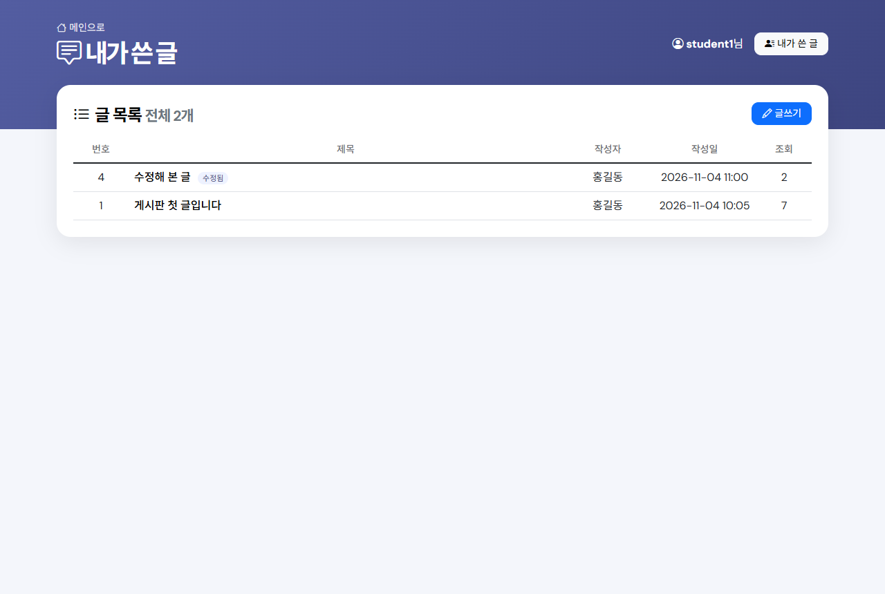
*② student1 의 "내가 쓴 글" : 본인 글만, 최신 글이 위로*

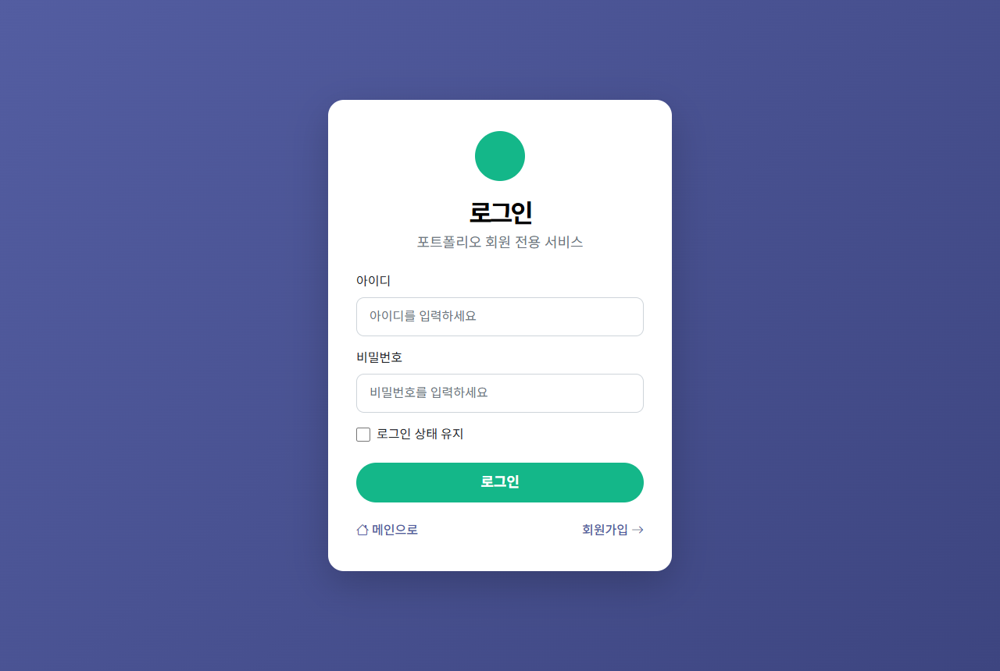
*② 로그인 안 하고 /board/my → 로그인 화면*


## Lighthouse 성능 점검

- 2026-09-16 로컬 서버 측정: 데스크톱 96점, 모바일 60점
- 가장 큰 저하 원인 1: 미사용 CSS 약 292 KiB(모바일 예상 절감 1.23초)
- 가장 큰 저하 원인 2: 미사용 JavaScript 약 85 KiB(모바일 예상 절감 0.40초)
- 원인: 원본 TemplateMo가 Bootstrap, Bootstrap Icons, Magnific Popup, jQuery 플러그인 전체를 불러오지만 현재 화면은 그중 일부만 사용합니다.
- 첫 화면 아래의 이미지는 `loading="lazy"`로 지연 로딩했습니다.
- Lighthouse 점수는 PC 상태와 네트워크 환경에 따라 달라질 수 있습니다.

## 실행

```powershell
.\mvnw.cmd spring-boot:run
```

브라우저에서 `http://localhost:8080`으로 접속합니다.

VS Code를 다시 연면 프로젝트 설정이 JDK 25를 새 터미널의 `JAVA_HOME`으로 지정합니다. 이미 열려 있던 터미널이라면 다음처럼 현재 세션만 맞춘 뒤 실행합니다.

```powershell
$env:JAVA_HOME = 'C:\Program Files\Java\jdk-25.0.4'
.\mvnw.cmd test
```
